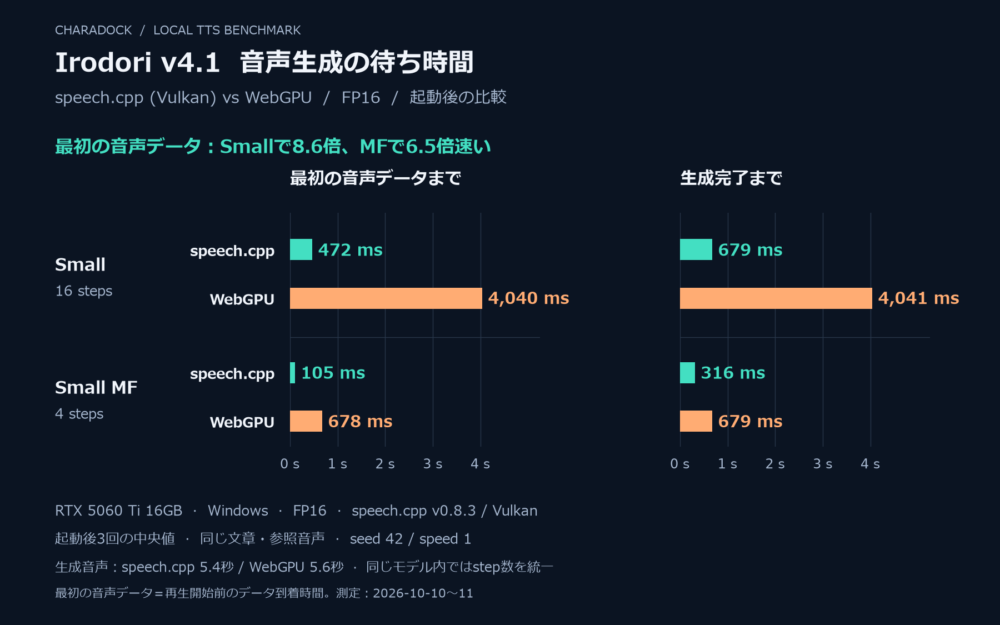
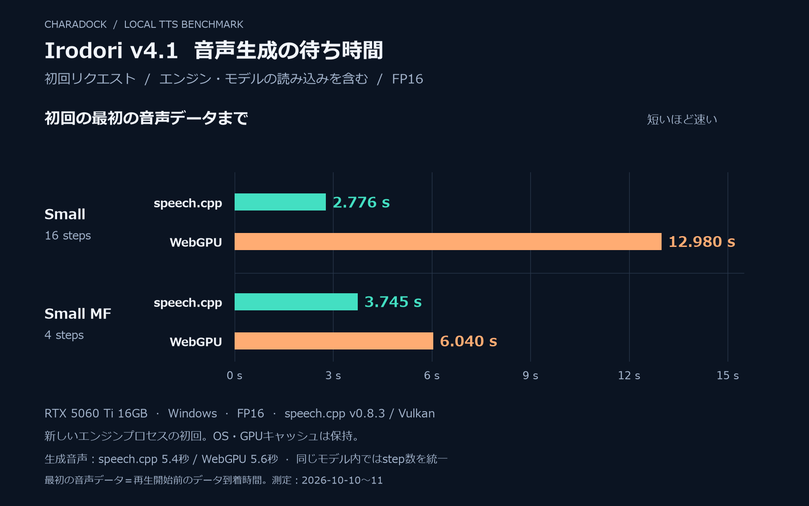

# Irodori v4.1: speech.cpp / WebGPU performance comparison

Measured on 2026-10-10–11, Windows, RTX 5060 Ti (16 GB), NVIDIA driver 591.86, Core i7-12700F, Electron 43.1.1, speech.cpp 0.8.3 (Vulkan).

## Results

Each row is the median of three requests after the first request in a fresh engine process. Cold is the first request, including engine and model loading; disk and driver caches were retained. No audio was played during the timing runs. MF rows are from the preceding integration benchmark on the same machine.

| Model / engine | First audio data | Generation complete | Generated audio | Cold first audio |
| --- | ---: | ---: | ---: | ---: |
| v4.1 Small / speech.cpp FP16 | 472 ms | 679 ms | 5.4 s | 2776 ms |
| v4.1 Small / WebGPU FP16 | 4040 ms | 4041 ms | 5.6 s | 12980 ms |
| v4.1 Small / WebGPU INT4 | 5997 ms | 5997 ms | 6.44 s | 14009 ms |
| v4.1 Small MF / speech.cpp FP16 | 105 ms | 316 ms | 5.4 s | 3745 ms |
| v4.1 Small MF / WebGPU FP16 | 678 ms | 679 ms | 5.6 s | 6040 ms |

For standard v4.1 Small at 16 steps, speech.cpp delivers first audio about 8.6 times faster than WebGPU FP16, and completes generation about 6.0 times faster on this sentence. WebGPU INT4 uses smaller model files but was slower than WebGPU FP16 here. This benchmark does not establish voice quality or performance for other sentence lengths or hardware.

## Figures for X

FP16 only; standard Small uses 16 steps and Small MF uses 4 steps in both engines.

PNG exports are 1800 × 1125 px; SVG versions are beside them. Regenerate from the measured JSON with `python scripts/render-speech-benchmark.py` (matplotlib and Windows Meiryo fonts).

## Conditions

- Text: 「新しい音声エンジンでも、いつもの声で話せるよ。」
- Caption: 「自然で明瞭な日本語。落ち着いた親しみやすい口調で話す。」
- Reference: builtin-hiro; SHA-256 recorded in the JSON.
- Standard RF model: 16 Euler steps, linear schedule; independent CFG text/speaker/instructions = 3/5/3, active at t = 0.5–1, masked unconditional speaker. Native defaults to 40 steps, so the harness explicitly sets 16.
- MF model: 4 MeanFlow steps.
- Seed 42; speed 1; automatic emotion disabled. Speaker and caption caches are available in the warm runs.
- Same numeric seed produces different waveforms between ports. Output lengths differ (native 5.4 s, WebGPU FP16 5.6 s, WebGPU INT4 6.44 s); duration prediction, trimming and quantization differ. The measurements compare the existing complete pipelines rather than forcing a fixed duration.
- Native decodes a completed sentence into four PCM chunks. WebGPU returns one completed WAV. First audio measures data availability before speaker playback and excludes the audio player's scheduling delay.

The model revisions, hashes, raw measurements, and WebGPU per-request metrics are in [the JSON](speech-cpp-irodori-v41-20261011.json).

## Reproduction

The opt-in [benchmark harness](../../scripts/speech-cpp-benchmark.cjs) uses the production speech.cpp client and WebGPU preload. It reads installed models and references without changing profile preferences. Run it with Windows Electron:

~~~powershell
electron.exe scripts/speech-cpp-benchmark.cjs SOURCE PROFILE OUTPUT all
~~~

Backend argument can also be native, webgpu, or webgpu-int4. Native RF parameters are applied only in this harness. The user-facing native provider remains the MF model.

The RF GGUF and its model license/conversion notices were added to the current profile in tts-models/speech-cpp-irodori-v4.1-small; WebGPU FP16 in tts-models/irodori-tts-v4.1-small-webgpu-fp16-r1. Model binaries and generated WAVs are outside Git.

References: [speech.cpp Irodori options](https://github.com/nyosegawa/speech.cpp/blob/v0.8.3/docs/models/irodori-tts.md), [RF GGUF revision](https://huggingface.co/sakasegawa/Irodori-TTS-v4.1-Small-GGUF/tree/3ebbd5ad88a3847c52f9e158d9dbe35178de5b98).

## Subsequent tail-speech correction

These measurements and figures predate the native reference-duration guard. The historical benchmark harness disables that guard and trailing-speech cleanup explicitly to reproduce the original conditions. Current reference synthesis first makes a private, text-only, one-step timing probe for each new sentence, then generates the requested voice/caption with that duration. Timing is cached (up to 128 sentences) and reused across seeds, captions and speeds. First audio for new text therefore includes the extra probe; these figures do not measure that corrected cold/new-text path.

With the active builtin-kohaku reference, seed 0, speed 1, the uncorrected voice-test sentences each lasted 4.32 seconds and contained unrelated trailing speech. Text-only timing reduced them to 2.52 and 1.96 seconds. The complete Link sentence 「新しい音声を、スマートフォンからも聞けるよ。」 remained one sentence at 4.56 seconds, with no unrelated trailing words in offline ReazonSpeech transcription for seeds 0, 42 and 1. On the warm worker, first audio for a new sentence was 216–293 ms in this diagnostic run; repeated text with cached timing was 58–83 ms. These are individual diagnostics, not replacement benchmark medians or human listening scores.

The opt-in `scripts/speech-cpp-tail-smoke.cjs SOURCE PROFILE OUTPUT [--raw]` records native WAVs and local diagnostic ASR without changing profile preferences. `scripts/speech-cpp-ui-smoke.cjs SOURCE PROFILE OUTPUT --skip-benchmark` verifies the voice test button, mascot, paired Link playback, interruption and engine switching through the production handlers.

Final correction validation: the exact reported sentence 「スマートフォンから聞けるよ。」 also matched offline transcription for all three seeds. The real-profile Windows Electron smoke check passed the settings test button, sandboxed desktop mascot, paired Link PCM playback/captions, immediate interruption and WebGPU/native selection, preserving character voice, history and appearance. The final repository suite passed 1,138 desktop tests and 58 Python tests (plus JavaScript runtime checks).

### Short terminal noise follow-up

The duration-corrected audio still contained terminal bursts of approximately 50–80 ms after quiet padding. The old 160 ms sustained-resumption threshold did not catch them, and ASR could report the intended words while missing the sound. Native completion now detects a burst up to 80 ms after at least 320 ms of quiet, keeps 80 ms of padding and fades to zero. The same endpoint handling applies to comma-containing sentences without enabling silence-based removal of their resumed clauses. One 40 ms PCM frame is withheld to allow a 5 ms endpoint fade even when the last chunk and EOF arrive separately.

With builtin-kohaku, seeds 0/42/1 and the five regression sentences, the corrected last 20 ms peak was below 0.003 of full scale and every final sample was zero. In the reported short phone sentence, seed 0's terminal peak fell from 0.556 to 0.003. Speech samples before the final quiet padding were byte-identical to the previous duration-corrected WAVs in all 15 cases. Local ASR matched 14 cases with 0.9 seconds of boundary silence; 1.5 seconds appeared to match the short voice-test case. Subsequent listening confirmed that the latter result hid an audible extra syllable (see below). This is waveform and diagnostic ASR evidence, not a claim of universal subjective quality. The endpoint regression suite passed 1,140 desktop tests and 58 Python tests.

The endpoint build also passed real-profile Windows Electron settings/mascot playback, paired Link captions/completion, Link audio stop without late held frames, replay of the same sentence, and native/WebGPU selection. Character voice, history and appearance were preserved, and the ordinary application was restarted with the shared profile.

### Short voice-test extra syllable

The actual settings button splits `音声テストです。これからよろしくね。` into two synthesis requests. With builtin-kohaku and seed 0, four MF steps generated an extra voiced segment after `です` following about 200 ms of quiet. This is too short a gap for the conservative tail gate, and shortening that threshold risks removing genuine pauses. Increasing real synthesis to six MeanFlow steps removed this reported syllable while retaining the selected voice, caption, seed, speed and sentence boundaries. The private timing probe still uses one step. Eight and twelve steps did not improve this regression over six.

The user confirmed that the production-split six-step recording had no unwanted sound between the sentences. All 15 generated sentence cases (five sentences, seeds 0/42/1) matched both local ASR boundary contexts, ended at zero, and had last-20-ms peaks below 0.003 of full scale. The diagnostic smoke check now requires both contexts to agree: a longer-context match cannot override a mismatch. Listening and waveform inspection remain necessary; ASR alone does not establish clean audio.

The tables and charts above retain the original four-step MF measurements. Six-step production synthesis does more diffusion work, and the one-step timing probe adds uncached-sentence work; these historic results are not six-step production latency figures.

The six-step real-profile Electron check captured the actual settings-button PCM; its WAV SHA-256 was identical to the recording the user approved. Mascot captions/playback, Link playback of the same two-sentence text, stop/replay, provider switching and preservation of character voice/history/appearance all passed. The full suite passed 1,140 desktop tests, 58 Python tests and the JavaScript runtime checks.

### Selectable native model and step count

The production settings now offer v4.1 Small MF and v4.1 Small with independent step counts (1–64), defaulting to 6 and 16 respectively. These native settings do not change the WebGPU model or generation recipe. Both models have their own pinned, verified installation and can be removed independently. Changing steps does not change voice, caption, seed or speed. The historical benchmark remains RF at 16 steps and MF at 4 steps.

Real-profile verification passed the actual settings button at MF 6, MF 8 and Small 24 steps, restored the per-model values, and verified Link playback at MF 6 and Small 16. Captured native requests identified both GGUFs with their selected real step counts; private probes remained one step. Model/step controls were inspected in the rendered Windows settings screen, and only the selected native model's download card was shown. The full suite passed 1,144 desktop tests and 58 Python tests plus JavaScript runtime checks. Voice, history and appearance were preserved.
